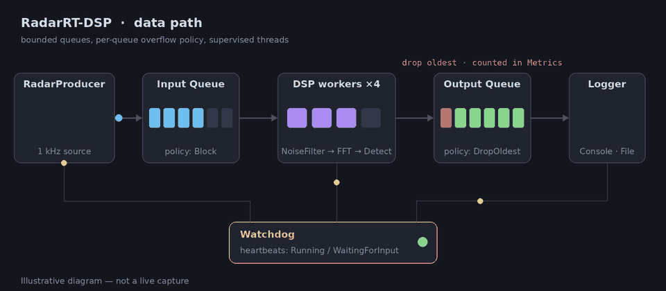
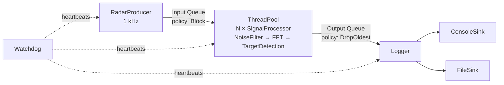
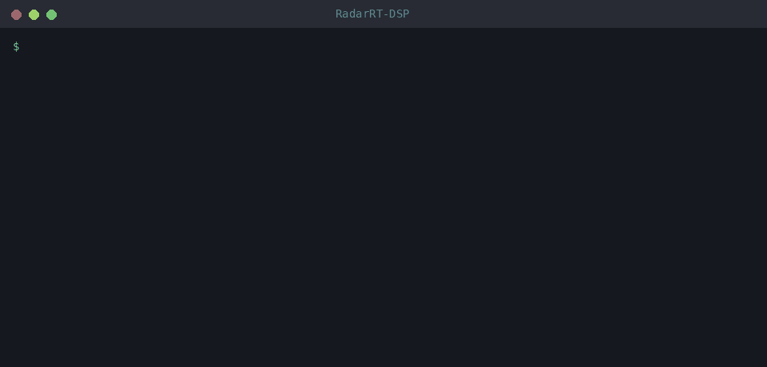

<div align="center">

# RadarRT-DSP

**Embedded Linux C++17 real-time radar processing system**

A simulated radar source feeds a pool of DSP workers, results are logged asynchronously,
and a watchdog supervises liveness — all under Linux realtime scheduling with an ordered,
loss-free graceful shutdown.

[](https://github.com/vitaliipavlov1/RadarRT-DSP/actions/workflows/ci.yml)
[](LICENSE)


<br>



<sub>Illustrative animation of the data path — not a live capture.</sub>

[Highlights](#highlights) ·
[Architecture](#architecture) ·
[Quick start](#quick-start) ·
[Tests](#tests) ·
[CI](#continuous-integration) ·
[Documentation](#documentation) ·
[License](#license)

</div>

---

> **Status:** All subsystems (producer, DSP thread pool, logger, watchdog, realtime
> support, signal handling, application assembly) are implemented and unit-tested;
> documentation is complete. CI builds and tests every preset, runs the unit suite under
> AddressSanitizer/UBSan and ThreadSanitizer, and enforces clang-format and clang-tidy
> (see [Continuous integration](#continuous-integration)).

## Highlights

| | |
| --- | --- |
| **Backpressure where data matters, loss where it doesn't** | The input queue *blocks* so no sampled signal is silently lost; the log queue *drops oldest* so slow disk I/O can never stall a `SCHED_FIFO` DSP worker. Every drop is counted. |
| **Priority-inversion safe** | Queues are guarded by a `PTHREAD_PRIO_INHERIT` mutex (`PiMutex`) because producer, DSP workers and logger run at different realtime priorities. |
| **State-aware watchdog** | Heartbeats carry `Running` / `WaitingForInput`, so an idle worker blocked on an empty queue is never reported as stalled. |
| **Ordered drain** | Two cooperating shutdown mechanisms (`ShutdownToken` + queue `close()`) guarantee no in-flight signal or pending log record is lost on `SIGINT`/`SIGTERM`. |
| **Deterministic & testable time** | A single injected `Clock` (`SteadyClock` / `ManualClock`) makes timeout logic testable with zero real sleeps. |
| **No allocation on the RT path** | DSP workers fill a move-only structured `LogRecord`; all formatting and I/O happen on the Logger thread. |
| **Graceful degradation** | Missing `CAP_SYS_NICE` or a low `RLIMIT_RTPRIO` logs a warning and continues at default scheduling instead of aborting. |
| **Clean engineering gates** | ASan/UBSan, TSan, clang-format and clang-tidy (warnings as errors) on every push. |

## Architecture



Cross-cutting: `Watchdog` (per-thread heartbeats), `RealtimeManager` (SCHED_FIFO,
`mlockall`, priority inheritance), `SignalHandler` (`signalfd`), `Metrics`, injected `Clock`.

The binding design decisions (D1–D8) live in [ARCHITECTURE.md](ARCHITECTURE.md); rendered
thread, queue and sequence diagrams are in [docs/diagrams.md](docs/diagrams.md).

## Quick start

**Requirements:** Linux · C++17 compiler (GCC or Clang) · CMake ≥ 3.21 · POSIX threads

```sh
cmake --preset release                 # configure
cmake --build --preset release         # build
./build/release/app/radarrt-dsp        # run — stop with Ctrl+C
```

The built binary is `radarrt-dsp` (target `radar_app`), under `app/` inside the preset's
build directory.

<div align="center">

<br>
<sub>A real run of <code>radarrt-dsp</code> (unprivileged, so SCHED_FIFO falls back to default scheduling).
The stream is a sampled excerpt; the shutdown summary is the unmodified program output.</sub>
</div>

### Build presets

| Preset | Description |
| --- | --- |
| `debug` | Debug build |
| `release` | Optimized build |
| `asan-ubsan` | Debug + Address/UB sanitizers |
| `tsan` | Debug + ThreadSanitizer |

Sanitizer builds need no special invocation beyond building the corresponding preset:

```sh
cmake --preset asan-ubsan && cmake --build --preset asan-ubsan && ./build/asan-ubsan/app/radarrt-dsp
cmake --preset tsan       && cmake --build --preset tsan       && ./build/tsan/app/radarrt-dsp
```

### What it does

There is no CLI/config-file loader yet (`app/main.cpp` runs the default `Config`); see
[docs/interview.md](docs/interview.md) for that as a possible extension. With the
default configuration the application:

* simulates a radar source at 1 kHz, processed by 4 DSP worker threads;
* logs DSP results and diagnostics to the console and to `radar.log` in the current
  directory;
* runs SCHED_FIFO realtime threads (producer/DSP/watchdog/logger priorities 80/70/60/40)
  and locks process memory (`mlockall`), unless privileges are missing — see below.

Stop it with `Ctrl+C` (SIGINT) or `SIGTERM`; the ordered drain (see
[docs/diagrams.md](docs/diagrams.md#shutdown-sequence-ordered-drain)) runs before the
process exits, printing a shutdown summary on stdout:

```text
[radar] shutdown summary:
  signals produced  : 3459
  signals processed : 3459
  input drops       : 0
  log-record drops  : 0
  deadline misses   : 1
  watchdog stalls   : 0
  thread exceptions : 0
```

<details>
<summary><b>RLIMIT_MEMLOCK note</b> — if thread creation fails with <code>EAGAIN</code></summary>

<br>

`realtime.lockMemory` (default: on) calls `mlockall(MCL_CURRENT | MCL_FUTURE)`, which
locks every page mapped afterwards — including each subsequently created thread's stack.
With the common 64 MB default `RLIMIT_MEMLOCK` (check with `ulimit -l`), the seven
realtime threads this application starts can exceed that budget, and thread creation then
fails with `EAGAIN` ("Resource temporarily unavailable"), which `main` reports and exits
non-zero. Either raise the limit (`ulimit -l unlimited`, or a systemd
`LimitMEMLOCK=infinity` / `/etc/security/limits.conf` entry, as is typical for realtime
deployments) or run with `Config::Params::realtime.lockMemory = false` (and typically
`enabled = false`, since `SCHED_FIFO` usually requires the same elevated privileges) if
the host does not allow raising it. This is inherent to `mlockall(MCL_FUTURE)` plus
several realtime thread stacks, not a `RealtimeManager` defect — see "Realtime and
priority-inversion notes" in [docs/diagrams.md](docs/diagrams.md).

</details>

## Tests

Unit tests cover the reusable infrastructure (`ThreadSafeQueue`, `ShutdownToken`,
`ManagedThread`, `Heartbeat`/`HeartbeatRegistry`, the `Watchdog` flagging policy, and
the queue's ordered-drain synchronization). Time-dependent logic is driven by the
injected `ManualClock`, so the tests are deterministic and use no real sleeps.

They use a **minimal in-repo assertion harness** (`tests/framework`), not an external
library: external test libraries are disallowed by default, and FetchContent would add
a network dependency to every clean build. The harness is a small static test registry
with `RADAR_TEST` / `RADAR_EXPECT` / `RADAR_ASSERT` macros.

Run them via CTest (one entry per suite):

```sh
ctest --preset debug          # also: --preset asan-ubsan, --preset tsan
```

Or run the test binary directly, optionally filtered to one suite:

```sh
./build/debug/tests/radar_tests              # all suites
./build/debug/tests/radar_tests watchdog     # one suite
```

> ThreadSanitizer needs ASLR entropy compatible with its shadow-memory mapping. On
> hosts whose `vm.mmap_rnd_bits` is too high (some newer kernels) the TSan binary
> aborts with "unexpected memory mapping"; run it under `setarch -R` to disable ASLR.

## Continuous integration

[GitHub Actions](.github/workflows/ci.yml) runs the quality gates on every push and
pull request:

| Gate | What it does |
| --- | --- |
| Build & test | Configures, builds and runs CTest for the `debug` and `release` presets |
| Sanitizers | Builds the `asan-ubsan` and `tsan` presets and runs the unit suite under each (any sanitizer report fails the job; the TSan job lowers `vm.mmap_rnd_bits` for the shadow-memory mapping) |
| clang-format | `clang-format --dry-run --Werror` over all headers and sources against [.clang-format](.clang-format) |
| clang-tidy | `clang-tidy` over every translation unit against [.clang-tidy](.clang-tidy) (warnings are errors; `tests/` carries [scoped overrides](tests/.clang-tidy)) |

The gates use the same tool versions (clang-format/clang-tidy 18) and invocations as
the local workflow above, so a clean local run matches CI.

## Documentation

| Document | Purpose |
| --- | --- |
| [ARCHITECTURE.md](ARCHITECTURE.md) | Authoritative architecture and decisions (D1–D8) |
| [docs/diagrams.md](docs/diagrams.md) | Rendered architecture / thread / queue / sequence diagrams |
| [docs/interview.md](docs/interview.md) | Design rationale in Q&A form: why each decision was made and what was rejected |
| [CONTRIBUTING.md](CONTRIBUTING.md) | Local workflow and quality gates |

## Repository layout

```text
include/radar/   public headers
src/             library sources
app/             application entry point
tests/           unit tests
cmake/           build modules (warnings, sanitizers, toolchains)
docs/            diagrams, design notes, assets
.github/         continuous integration
```

## License

Licensed under the [Apache License, Version 2.0](LICENSE). See [NOTICE](NOTICE) for
attribution.
